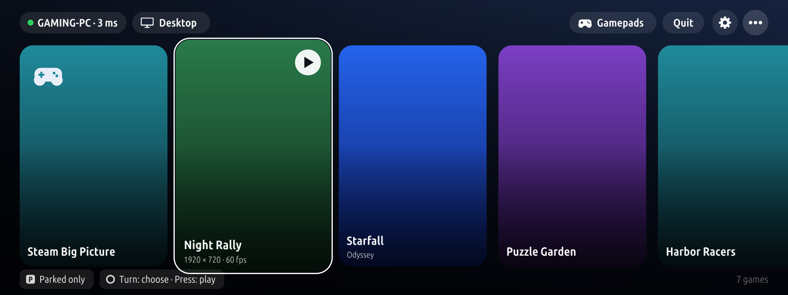
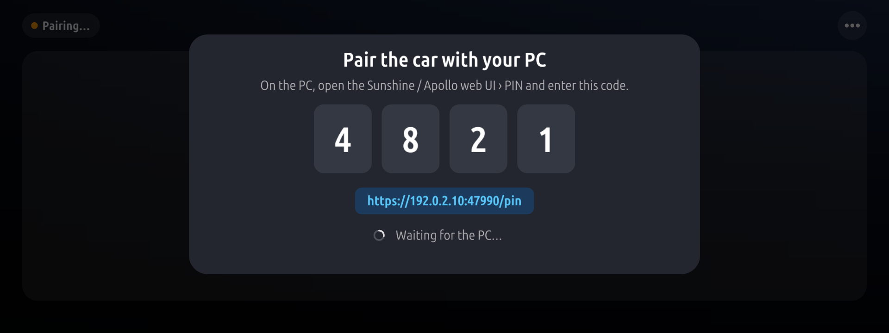
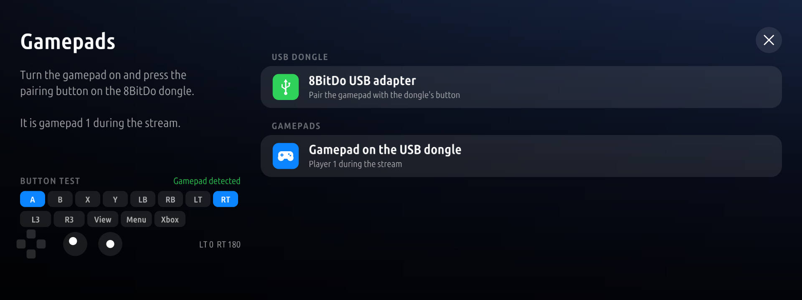
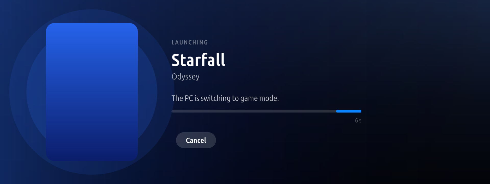

# Moonride

**Use at your own risk. Moonride is an independent project, not affiliated with or endorsed by BMW, Moonlight,
NVIDIA, LizardByte (Sunshine), Apollo, Vibepollo, Tailscale or WireGuard; their names are their owners' trademarks
and are used only to say what Moonride works with.** By default it streams only while the car is parked.

Moonlight game streaming for the BMW iDrive 7 head unit (MGU). Moonride streams games or the desktop from your
PC to the car's centre screen at 1920 x 720, 60 fps, with the sound on the car's speakers. You play with a USB
gamepad, the touchscreen or the iDrive controller.

It is installed from the MGU Store. Nothing in it is tied to one car, PC or network: you pair it with your own PC
the first time you open it.


*Home: the PC's apps as cards (the iDrive controller is on one), with the "•••" menu open.*


*Pairing: enter the PIN in the host's web UI.*


*Gamepads: the USB pad and a live button test.*


*Launching: shown until the stream's first picture.*

The screenshots use demo data (a made-up PC and games, no box art).

## What you need

- An iDrive 7 car (MGU, ID7 HMI) with the [MGU Store](https://github.com/robertnisipeanu/mgu-store) installed.
- From the MGU Store: **mgu-render** (the Store's renderer, 0.6.8 or newer) and **mgu-uplink**, connected to a
  Wi-Fi network (or a USB network adapter) that reaches your PC.
- A PC running a GameStream host: [Sunshine](https://github.com/LizardByte/Sunshine), Apollo or Vibepollo.
- A USB gamepad that shows up as an XInput (Xbox 360) controller, for example an 8BitDo USB adapter in X-input
  mode. Without one you can still use the touchscreen (it works as a mouse) and the iDrive controller (arrow keys
  and Enter).

## Install

1. In the MGU Store, open **Sources** and add `JustAnotherPU/moonride` on the **Releases** channel
   (as a default source: `JustAnotherPU/moonride:releases`).
2. Add `JustAnotherPU/mgu-apps:releases` too (it is a default source once accepted). It has the shared tools
   **Node.js 22** (`jap-node22`), which Moonride's service runs on, and `jap-wireproxy` for playing away from home.
3. Install **Moonride**. The Store installs what it needs first: the **Moonride streaming service**
   (`jap-moonride`), Node.js 22 from mgu-apps, and mgu-render if it is missing.
4. If the Store says a restart is pending, restart the head unit before the first start.
5. Optional, to play away from your PC's network: install `jap-wireproxy` from mgu-apps or IterioDev's Tailscale,
   see [Playing over 5G](#playing-over-5g).

## First run: pairing

1. Open Moonride, then **•••** › **Settings**. Set **Host IP** (four numbers) to your PC's address, for
   example its LAN address (such as `192.0.2.20`), or its Tailscale address `100.x.y.z`. There is no default.
2. Back on the home page, press **Pair**. A four-digit PIN appears on the car screen.
3. On the PC, open the host's web UI (`https://<pc>:47990`), go to **PIN** and enter the code.
4. The PC's apps appear as cards. Pick one with the touchscreen or the iDrive controller to start it.
   BACK, or leaving the game screen, ends the stream and quits the app on the PC.

The pairing is kept on the head unit (`/var/opt/jap-moonride/state`, readable by the service only).

## Settings

| Setting | |
|---|---|
| Parked only | On by default. See [Driving](#driving). |
| Resolution | 1920 x 720 (the whole screen) or 1280 x 720 (pillarboxed). |
| Codec | Auto (HEVC through the tunnel, H.264 on the local network), HEVC always, H.264 always. |
| Bitrate | 3 to 20 Mbit/s, 8 by default; capped at 6 Mbit/s through the relay. |
| Sound | The car's speakers, or muted. |
| Performance statistics | Moonlight's overlay over the game. In a game, hold the iDrive controller pressed for 3 s to toggle it. |
| Host IP | Your PC's IPv4 address. |

## Driving

The stream is **parked only by default**. Above 3 km/h it stops, and Start is refused. If the car's speed cannot
be read, the car counts as moving.

The **Parked only** setting can be turned off, but only while the car is parked. Turning it off shows this
disclaimer on the car screen first, and the setting changes only after **I accept** (**Cancel** keeps it on):

> Streaming while driving is for passengers only. The driver must never watch or operate it. You use this at your
> own risk; the authors accept no liability for any damage, injury, fine or loss. Check that it is legal where you
> drive.

The acceptance is remembered until Parked only is turned back on; turning it off again asks again. With it off,
the stream keeps running while the car moves.

### No warranty

Moonride is free software, provided "as is", without warranty of any kind, to the extent permitted by applicable
law. In no event will the authors be liable for damages arising from its use. See sections 15 (Disclaimer of
Warranty) and 16 (Limitation of Liability) of the GNU General Public License v3 in `LICENSE`.

## Sound

The PC's sound plays on the car's speakers through the head unit's audio manager, the way a phone source does.
This was tested on a BMW with iDrive 7 (MGU). Other models and audio systems may need other settings, or may stay silent.

## Gamepads

- **USB**: an XInput pad (or an 8BitDo USB adapter in X-input mode) in a USB port of the car. It is controller 1 on
  the PC, with rumble. Hold **View + Menu** to end the stream and quit the game.
- **Touchscreen**: a mouse on the PC's desktop and in games that take one.
- **iDrive controller**: arrow keys, Enter and the wheel.
- Bluetooth pads are not supported in this release.

## Playing over 5G

When the PC is not on the car's network, Moonride can reach it through a tunnel to your home. It works with two
tools, each with a SOCKS5 proxy that only the head unit can reach:

- `jap-wireproxy` from [mgu-apps](https://github.com/JustAnotherPU/mgu-apps) connects to your own WireGuard server
  (on your router, for example). Its proxy is on `127.0.0.1:1065`.
- `iteriodev-tailscale` from [IterioDev/car-apps](https://github.com/IterioDev/car-apps) runs
  [Tailscale](https://tailscale.com) on the head unit. Its SOCKS5 proxy is off until you enable it, and then it is on
  `127.0.0.2:1055`.

Moonride first tries the PC directly. If that fails, it tries jap-wireproxy, then Tailscale, and relays the stream
through the first one that reaches the PC. One of them is enough; with both, Tailscale is the backup.

1. Give the car internet through mgu-uplink (a phone hotspot, an LTE stick, ...).
2. For your WireGuard server: install `jap-wireproxy` from the `JustAnotherPU/mgu-apps:releases` source and set it
   up as its README says. Keep the PC's LAN address as **Host IP** if the server lets the car reach your home
   network.
3. For Tailscale: install `iteriodev-tailscale` and IterioDev's Tailscale app from IterioDev/car-apps, and sign in
   with the app (it shows the login QR code). Then enable the SOCKS5 proxy, as root on the head unit:

   ```sh
   echo 1055 > /var/opt/iteriodev-tailscale/socks5-port && systemctl restart iteriodev-tailscale
   ```

4. With Tailscale, the PC must be on the tailnet: either install Tailscale on the PC and set **Host IP** to its
   `100.x` address, or keep the PC's LAN address and run a [subnet router](https://tailscale.com/kb/1019/subnets)
   at home.
5. With Codec on Auto, Moonride picks HEVC through the tunnel (less bitrate for the same picture).

How each tool works and how to keep it safe is in its own README. On Moonride's side:

- While Moonride relays a stream, it listens on `127.0.0.1` on Moonlight's ports (TCP 47984, 47989, 48010; UDP
  47998-48000) and forwards them to the PC: during that time any program on the head unit can reach the PC's
  GameStream ports through it.
- The Moonride service's control socket (`/run/jap-moonride/ctl.sock`, mode 0660, group `tm_oap_app`) is open to
  every app on the head unit (they all share that group), not to Moonride alone: an installed app could pair,
  start a stream or send input. Install only apps you trust.

## Tested on

| | |
|---|---|
| Car | BMW X5 xDrive45e (G05), iDrive 7 (MGU, ID7 HMI), firmware P18_23w44.2-1-3 |
| Renderer | mgu-render 0.6.12 |
| Host | Vibepollo on Windows 11, with a virtual display at the client's resolution |
| Pad | 8BitDo USB adapter in X-input mode |

With plain Sunshine, give the host a 1920 x 720 (or 1280 x 720) display mode, or a virtual display at that size:
Moonride asks for that size and does not change the host's display, so a 16:9 desktop comes out stretched or
letterboxed. Reports from other cars and hosts are welcome in the issues.

## Known limits

- iDrive 7 (ID7) only, tested on one car (above).
- The stream starts only once the car reports its speed. If your car or firmware does not give Moonride the
  vehicle speed, the page says the speed is unreadable and streaming stays blocked.
- If Moonride is killed in the middle of a stream, the iDrive touchpad can stay in its handwriting (mouse)
  mode. Open Moonride once, or any text field on the car, to clear it.
- The video is not encrypted on the network (the sound is), as in Moonlight on a LAN. Through jap-wireproxy or
  Tailscale the whole link is encrypted.
- The stream is decoded in hardware (Intel Media SDK). 1920 x 720 at 60 fps is the target. A weak Wi-Fi or mobile
  link shows up as dropped frames: lower the bitrate.
- Popups and the reversing camera cover the stream. The head unit's own shortcuts still work.
- One stream and one pad at a time. No Bluetooth pads, no microphone.

## Uninstall

1. In the MGU Store, uninstall **Moonride**, then the **Moonride streaming service** (`jap-moonride`). Node.js 22
   stays installed for other apps, and so do jap-wireproxy and Tailscale if you installed them; remove them too if
   nothing else uses them.
2. On the PC, open the host's web UI and remove the car from its paired clients, so the pairing key left on the
   head unit is no longer accepted.

## Repository layout

| Path | |
|---|---|
| `apps/jap_moonride`, `test/app` | the app (Node 8, on the head unit), built with the kit, and its tests |
| `kit/` | the app kit (build script and runtime) |
| `daemon/` | `moonlightd.js`, the service's control plane (Node 22): pairing, launch, the relay |
| `native/mgu-moonlight` | the streaming binary (C++): moonlight-common-c, MSDK decoder, audio, USB pads |
| `tools/jap-moonride` | the service's tool: manifest, unit, build script (`jap-node22` and `jap-wireproxy` are in mgu-apps) |
| `release/` | makes the Store release (`catalog.json` and the artifacts) |

## Building

You need Docker (on a Mac: colima; set `TMPDIR` to a folder outside `/var/folders`), Python 3, Node.js, and a
checkout of the [MGU Store](https://github.com/robertnisipeanu/mgu-store) for its packer (`MGU_STORE=<path>`).
BMW's oap-sdk is never part of this repository or of a release. To build or test the app you need your own copy,
extracted from your head unit with `kit/tools/extract_sdk.js`, in `./oap-sdk`.

```sh
python3 kit/tools/build.py jap_moonride               # the app: dist/jap_moonride@<version>.tgz
make -C native/mgu-moonlight target                   # the streaming binary (x86_64, glibc 2.27)
sh tools/jap-moonride/build.sh                        # the tool artifact, in dist/
sh release/release.sh                                 # dist/release/: catalog.json + artifacts (no oap-sdk)
```

Tests:

```sh
# the app against a fake service and renderer, on Node 8 (the head unit's)
docker run --rm --network none -v "$PWD:/w" -w /w node:8.16.0-alpine \
  sh -c 'mkdir -p /tmp/t && node test/app/smoke.js /w/dist/jap_moonride /tmp/t'
docker run --rm -v "$PWD:/w" -w /w node:8.16.0-alpine node test/app/screentouch.js
# the service's PNG reader and relay, on Node 22 (relay_test needs 127.0.0.2-4: Linux)
docker run --rm --network none -v "$PWD:/w" -w /w/daemon node:22-alpine \
  sh -c 'node test/png.js && node test/relay_test.js'
```

## Releasing

Make a GitHub release named `catalog` (tag `catalog`) and upload every file of `dist/release/`: `catalog.json`,
the two `.tgz` artifacts and `jap_moonride.png`. The Store reads `catalog.json` from that release and checks
every download against its size and sha256. For a new version, run `release/release.sh` again and replace the
release's files.

## License

GPL-3.0-or-later (`LICENSE`). Copyright (C) 2026 JustAnotherPU. Third-party components and their licences are
listed in `THIRD_PARTY_LICENSES/`.
